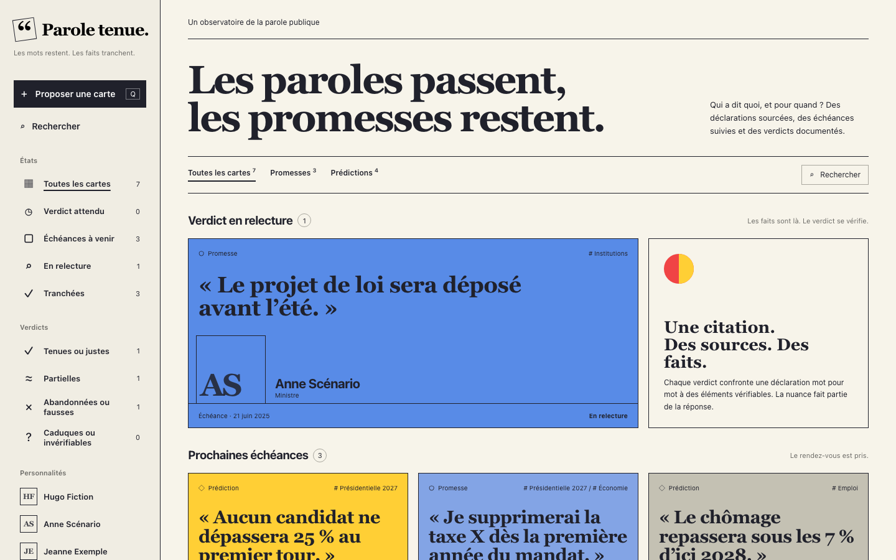
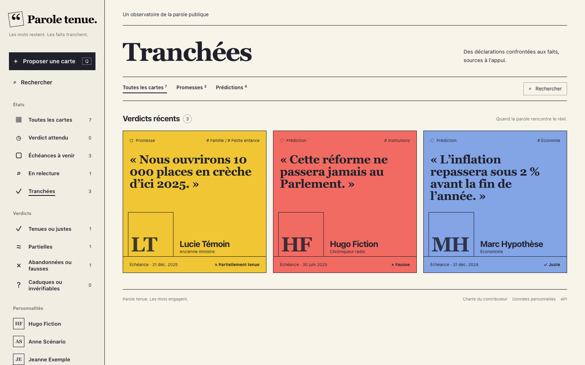
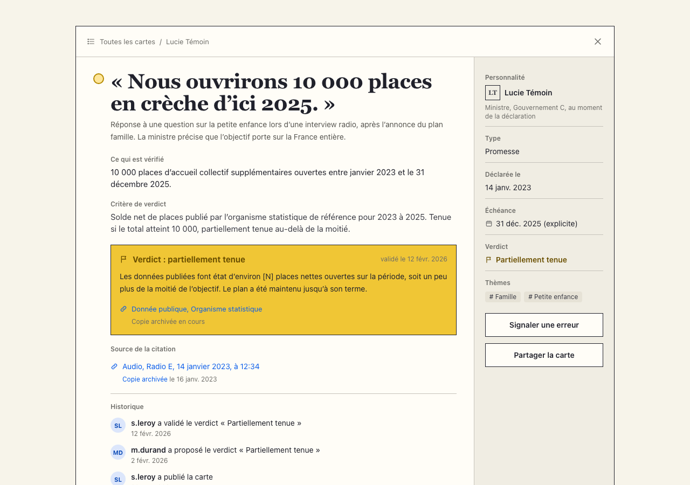
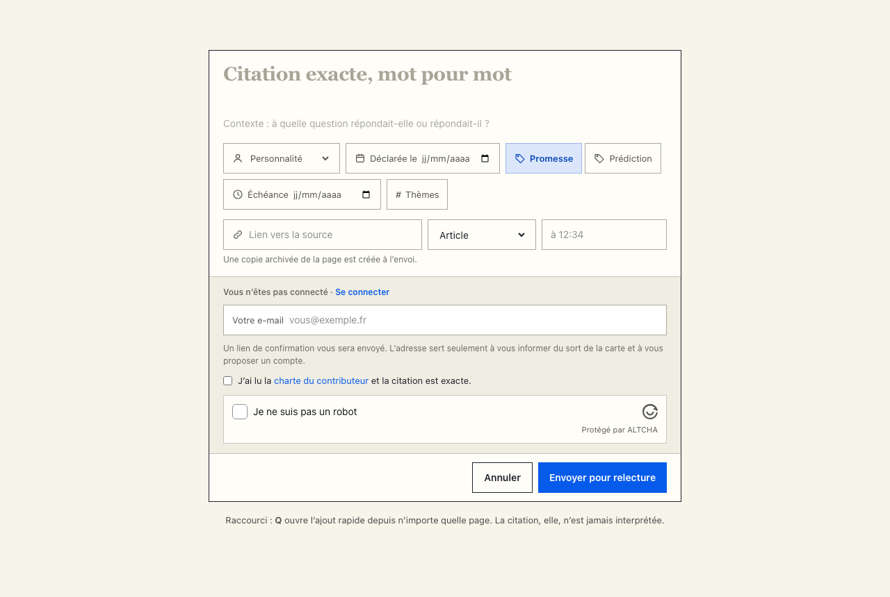
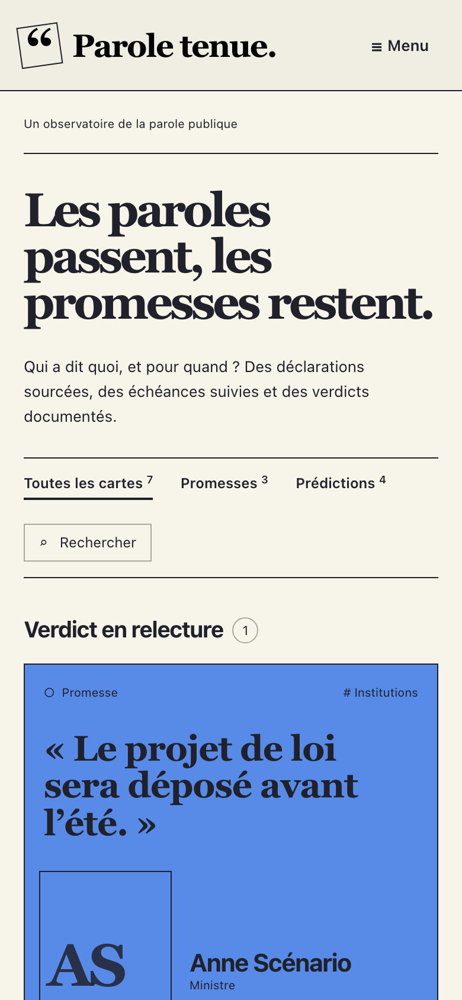
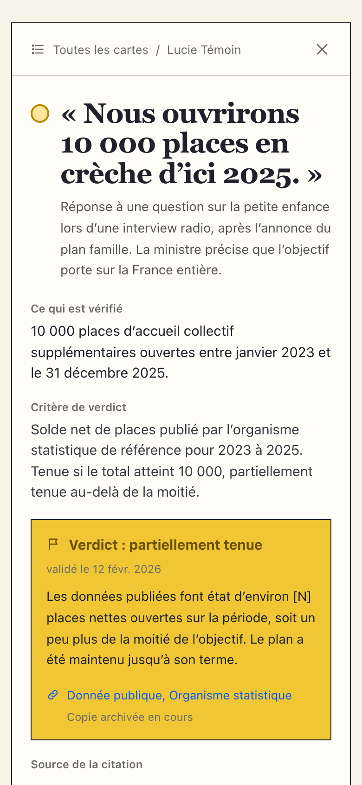

> [!WARNING]
> Ce projet a été vibecodé avec l’aide de l’intelligence artificielle.

# Parole tenue

[](https://github.com/charlescoiffier/prophet/actions/workflows/deploy.yml)

Un registre des promesses et des prédictions de personnalités publiques (politiques, journalistes, éditorialistes,
économistes) : chaque déclaration est citée mot pour mot, datée, sourcée et archivée, puis **tranchée** par un verdict
sourcé quand son échéance arrive.

**Le site : https://paroletenue.charlescoiffier.fr** (en test : l’accès est protégé par un mot de passe).

« Parole tenue » est le nom de travail affiché ; « prophet » est le nom du dépôt. Première échéance forte : l’élection
présidentielle française, dont le premier tour a lieu le 18 avril 2027.

## Aperçu



| Les cartes tranchées | La fiche d’une carte |
|---|---|
|  |  |

| Proposer une carte (touche Q) | Sur téléphone | Une fiche sur téléphone |
|---|---|---|
|  |  |  |

Les personnalités, citations et verdicts des captures sont **fictifs** (données de démonstration).

---

# Pour tout le monde

## Le projet en bref

Les responsables publics promettent, les commentateurs prédisent, et l’on oublie vite qui a dit quoi. Parole tenue
garde la trace : une **carte** réunit une déclaration, la personne qui l’a faite, la date, le contexte et la source
d’origine (avec l’horodatage pour une vidéo ou un audio). Une copie de chaque page citée est archivée automatiquement
sur la Wayback Machine, pour que la preuve ne disparaisse pas avec le lien.

Le moment venu, un membre propose un **verdict** appuyé sur des sources (une donnée officielle de préférence), et un
modérateur le vérifie avant de le publier. On juge des **faits**, jamais des intentions. Il n’y a ni argent en jeu ni
pourcentage de réussite : le bilan d’une personnalité est un simple décompte de ses cartes tranchées.

## La vie d’une carte

1. **Proposée** par un visiteur ou un membre. Sans compte, la carte attend que l’adresse e-mail soit confirmée par
   le lien reçu ; sans confirmation sous 7 jours, elle est effacée avec l’adresse.
2. **En modération** : un modérateur vérifie la citation et la source, peut préciser la rédaction (« ce qui est vérifié »,
   « critère de verdict »), puis la **publie** ou la **refuse** avec un motif. L’auteur est prévenu par e-mail.
3. **Publiée** : elle attend son échéance. Tout le monde peut **signaler une erreur**.
4. **Verdict proposé** : un membre propose un verdict sourcé. Une seule proposition à la fois par carte.
5. **Tranchée** : un modérateur valide le verdict (ou le refuse, et la carte attend une nouvelle proposition).

**Personne ne décide sur sa propre proposition**, modérateurs compris (seule exception : l’administrateur peut publier
ses propres cartes, et l’historique public le signale). Chaque décision est inscrite dans l’**historique public** de la
carte : qui a fait quoi, quand, et ce qui a changé.

## Les verdicts

| Tonalité | Promesse | Prédiction | Couleur de la carte |
|---|---|---|---|
| Tenues ou justes | tenue | juste | bleu |
| Partielles | partiellement tenue, compromis | partiellement juste | jaune |
| Abandonnées ou fausses | abandonnée | fausse | rouge |
| Caduques ou invérifiables | caduque | invérifiable | gris |

Une carte en relecture est **bleu soutenu** ; une carte encore ouverte alterne jaune, bleu clair et gris.
Le critère de verdict est écrit sur la carte avant l’échéance : on sait d’avance avec quelle donnée elle sera tranchée.

## Utiliser le site

- **La barre latérale** classe les cartes par **état** (toutes, verdict attendu, échéances à venir, en relecture,
  tranchées), par **verdict**, par **personnalité** et par **thème**. Sur téléphone, elle se replie derrière « Menu ».
- **Les onglets** Promesses et Prédictions filtrent chaque vue.
- **Rechercher** : recherche plein texte en français dans les citations et leur contexte (« logement » trouve
  « logements »).
- **La page d’une personnalité** montre son affiliation au moment de chaque déclaration et son bilan.
- **Proposer une carte** : touche `Q` depuis n’importe quelle page. Sans compte, il faut laisser son adresse e-mail et
  passer une vérification anti-robot (sans cookie). La citation n’est jamais réécrite automatiquement.
- **Sur la fiche d’une carte** : signaler une erreur, partager le lien, et pour les membres, proposer un verdict.
- **Un compte** (pseudo public, adresse jamais publiée) permet de proposer des verdicts et de suivre ses propositions.
  En confirmant son adresse, on récupère les cartes proposées auparavant sans compte avec la même adresse.

| Touche | Effet |
|---|---|
| `Q` | Ouvrir l’ajout rapide (sauf pendant la saisie dans un champ). |

## Données personnelles

- L’adresse e-mail d’un visiteur sert seulement à confirmer sa proposition, à le prévenir de la suite et à lui proposer
  un compte. Elle n’est jamais publiée et disparaît de la carte dès qu’un compte la reprend.
- Le texte d’un signalement n’est lu que par les modérateurs ; l’historique public n’en montre que l’existence.
- Aucun cookie publicitaire, aucune mesure d’audience tierce ; seul un cookie de session garde la connexion.
- Les textes de la charte du contributeur et de la page « Données personnelles » sont encore des brouillons.

---

# Pour les développeurs

## Démarrage

Prérequis : PHP 8.4, Composer, Node.js 22 ou plus récent, PostgreSQL 17.

```bash
composer install
npm install
cp .env.example .env
php artisan key:generate
psql -h 127.0.0.1 -p 5433 -d postgres -c "create role prophet login"
createdb -h 127.0.0.1 -p 5433 -O prophet prophet
createdb -h 127.0.0.1 -p 5433 -O prophet prophet_test
php artisan migrate --seed      # données de démonstration fictives
npm run build                   # ou npm run dev
php artisan serve               # http://localhost:8000
```

Le PostgreSQL local écoute sur le port **5433** (adapter `DB_PORT` sinon). Le seeder crée des comptes `admin`, `s.leroy`
(modératrice), `m.durand` et `j.martin`, tous en `@example.test`, mot de passe `password`. Le panneau de modération est
sur `/moderation`, la documentation de l’API sur `/docs/api`.

```bash
php artisan test --compact      # tests (Pest), sur la base prophet_test
vendor/bin/pint --dirty         # mise en forme du code
npm run capture:readme          # régénère les images du README (Chrome requis)
```

## Technologies

Une seule application [Laravel 13](https://laravel.com/) porte l’API, le site public et la modération :

| Brique | Choix |
|---|---|
| Base de données | PostgreSQL (contraintes `CHECK`, index uniques partiels, recherche plein texte `french`) |
| Site public | Blade + [Livewire 4](https://livewire.laravel.com/), rendu serveur, [Tailwind CSS 4](https://tailwindcss.com/), polices DM Sans et Newsreader (Bunny Fonts) |
| Modération | [Filament 5](https://filamentphp.com/), panneau `/moderation` |
| API | REST JSON sous `/api/v1`, [Sanctum](https://laravel.com/docs/sanctum), documentation OpenAPI par [Scramble](https://scramble.dedoc.co/) |
| Tâches de fond | files Redis, [Horizon](https://laravel.com/docs/horizon), planificateur |
| Anti-robot | [ALTCHA](https://altcha.org/) (preuve de travail, sans cookie) + limites de débit |
| Tests | [Pest](https://pestphp.com/), sur PostgreSQL |
| Hébergement | Docker derrière Traefik sur un VPS, image construite par GitHub Actions |

## Organisation du code

La règle d’or : **la logique métier vit dans les classes d’action et les Policies**. Contrôleurs d’API, composants
Livewire et ressources Filament se contentent de les appeler ; aucune règle n’est écrite dans un contrôleur ou une vue.

| Dossier / fichier | Rôle |
|---|---|
| `app/Actions/` | Une classe par opération : `Cards/ProposeCard`, `PublishCard`, `RejectCard`, `UpdateCard`, `ConfirmCardEmail`, `Verdicts/ProposeVerdict`, `ApproveVerdict`… Chacune vérifie la Policy et écrit dans le journal (`RecordActivity`). |
| `app/Policies/` | Qui peut faire quoi (règle 4 : personne ne décide sur sa propre proposition). |
| `app/Enums/` | Statuts, types, verdicts, rôles ; libellés français dans `lang/fr/enums.php`. |
| `app/Models/` | Modèles Eloquent (clés UUID). `ActivityLog::publicSentence()` écrit l’historique en phrases. |
| `app/Jobs/ArchiveSource.php` | Archivage Wayback Machine d’une source. |
| `app/Livewire/` | Site public : `Board` (accueil, vues, personnalité, thème, recherche), `Cards/ShowCard`, `Cards/ProposeCardForm`, comptes. |
| `app/View/Appearance.php` | Couleurs des cartes, statuts, tonalités de verdict (classes Tailwind écrites en entier). |
| `app/Filament/` | Panneau de modération ; boutons réutilisables dans `app/Filament/Actions`. |
| `app/Http/Controllers/Api/V1/` | Contrôleurs minces de l’API ; Form Requests et ressources à côté. |
| `app/Support/AltchaGuard.php` | Création et vérification des défis anti-robot. |
| `resources/views/` | Vues Blade et Livewire ; `resources/css/app.css` porte la charte (`@theme`). |
| `database/seeders/` | Thèmes (`ThemeSeeder`, aussi en production) et données de démonstration fictives (`DemoSeeder`). |
| `deploy/` | `docker-compose.yml` de production et modèle des secrets (`env.example`). |
| `docs/` | Spécification, maquettes (`docs/maquettes/editoriale` : charte actuelle), images du README. |

## Les règles et où elles sont garanties

| Règle | Où |
|---|---|
| 1. Sans compte, la carte attend la confirmation de l’adresse | `ProposeCard`, lien signé `/confirmations/{card}`, `ConfirmCardEmail` |
| 2. Seuls modérateurs et admin publient, refusent (avec motif) ou modifient | `CardPolicy`, `PublishCard`, `RejectCard`, `UpdateCard`, notifications à l’auteur |
| 3. Seul un membre confirmé propose un verdict, avec une source au moins | `VerdictPolicy::propose`, `ProposeVerdict` |
| 4. Personne ne décide sur sa propre proposition | Policies + contrainte `verdicts_not_self_decided` |
| 5. Une seule proposition de verdict en attente par carte | verrou dans `ProposeVerdict` + index unique partiel `verdicts_one_pending_per_card` |
| 6. Chaque action de modération est journalisée, l’historique est public | `RecordActivity`, table `activity_logs` |
| 7. Chaque source est archivée | `AttachSources` (seul point de création des sources) → `ArchiveSource` |
| 8. Les cartes d’un visiteur rejoignent son compte | `AttachGuestCards`, à la confirmation de l’adresse (événement `Verified`) |

## Archivage des sources

`ArchiveSource` demande la capture à « Save Page Now » (`web.archive.org/save`), puis interroge l’API de disponibilité
(`archive.org/wayback/available`). Une capture antérieure à l’enregistrement de la source est refusée : elle ne prouverait
pas ce que la page disait. Tant que la capture n’est pas disponible, ou si archive.org répond 429, le job se replace en
file (5 minutes), pendant 24 heures au plus. `sources:archive-missing` relance chaque nuit les sources restées sans copie.
Des clés d’archive.org (`WAYBACK_ACCESS_KEY`, `WAYBACK_SECRET_KEY`) donnent un quota plus large qu’en anonyme.

## API

API REST en JSON sous `/api/v1`, documentée automatiquement sur **`/docs/api`** (OpenAPI 3.1). Les lectures sont
publiques ; les écritures demandent un jeton Sanctum (`Authorization: Bearer`), sauf la proposition d’une carte et le
signalement, ouverts aux visiteurs avec une adresse e-mail et la solution d’un défi anti-robot (`GET /api/v1/altcha`).

| Méthode | Route | Qui |
|---|---|---|
| `GET` | `/cards`, `/cards/{id}`, `/deadlines`, `/public-figures`, `/public-figures/{slug}`, `/themes`, `/verdicts/{id}` | public |
| `POST` | `/cards`, `/cards/{id}/reports` | visiteur (e-mail + anti-robot) ou membre |
| `POST` | `/accounts`, `/sessions`, `/password/forgot`, `/password/reset` | public |
| `POST` | `/cards/{id}/verdicts` | membre |
| `PATCH`, `POST` | `/cards/{id}`, `/cards/{id}/decision`, `/verdicts/{id}`, `/verdicts/{id}/decision`, `/public-figures` | modérateur |
| `GET` | `/moderation/queue` | modérateur |

Choix de conception : un enum est exposé en `{value, label}` (code stable et libellé français) ; une carte non publique
répond 404, pas 403, pour ne pas révéler son existence ; l’adresse d’un visiteur et le texte d’un signalement ne sortent
jamais ; le bilan d’une personnalité est un décompte, jamais un pourcentage. Limites : 120 requêtes par minute, 10
propositions ou signalements par heure et par adresse IP.

## Anti-robot

Le défi ALTCHA est une preuve de travail : le navigateur calcule, sans cookie ni service extérieur, environ une seconde.
Il est exigé des visiteurs sans compte pour proposer une carte, signaler une erreur et créer un compte (site et API).
Une solution ne sert qu’une fois (mémorisée en cache jusqu’à l’expiration du défi, 10 minutes). Dans les formulaires
Livewire, elle est vérifiée **après** les autres champs, pour ne pas être gâchée par une faute de frappe
(`VerifiesAltcha`). Difficulté : `ALTCHA_COST`, `ALTCHA_COUNTER_MIN` et `ALTCHA_COUNTER_MAX`.

## Tests

`php artisan test --compact` lance plus de 230 tests Pest sur PostgreSQL (base `prophet_test`) : règles métier, Policies,
actions, API, écrans Filament, composants Livewire, anti-robot, commandes planifiées. Aucun test n’appelle de service
extérieur (`Http::preventStrayRequests()` dans `tests/TestCase.php`) ; les défis anti-robot sont résolus pour de vrai
avec une difficulté minimale (`altchaSolution()` dans `tests/Pest.php`).

## Images du README

`npm run capture:readme` (`scripts/capture-readme.mjs`) recharge la base locale avec les données de démonstration, sert
le site avec le serveur intégré de PHP (sans le bandeau « Version de test ») et pilote Chrome par son protocole de
débogage, avec le WebSocket natif de Node : c’est ce qui permet d’émuler un vrai téléphone. Les images sont écrites dans
`docs/images/` et versionnées. Prérequis : Google Chrome (ou `CHROME_PATH`).

## Mise en ligne

Le site tourne sur un VPS dans Docker, derrière Traefik qui gère le HTTPS (infrastructure commune de
`charlescoiffier.fr`). Chaque push sur `main` lance le workflow `.github/workflows/deploy.yml` : tests sur PostgreSQL,
construction de l’image (`Dockerfile`, publiée sur GHCR), puis déploiement par SSH.

`deploy/docker-compose.yml` décrit cinq conteneurs, avec des limites de mémoire et de processeur (le VPS n’a qu’un cœur,
partagé avec d’autres sites) :

| Conteneur | Rôle |
|---|---|
| `app` | Site, API et modération (Nginx + PHP-FPM). Au démarrage : migrations, caches. |
| `horizon` | Files d’attente : e-mails, archivage des sources. |
| `scheduler` | Purge des cartes non confirmées, relance de l’archivage. |
| `postgres` | Base de données (volume `pgdata`). |
| `redis` | Files, cache et sessions (volume `redisdata`). |

Les secrets sont dans `~/srv/paroletenue/.env` sur le VPS (modèle : `deploy/env.example`). Commandes utiles, depuis
`~/srv/paroletenue` :

```bash
docker compose exec app php artisan db:seed --force                                    # thèmes (une fois)
docker compose exec -it app php artisan users:create-admin vous@exemple.fr pseudo      # compte admin
docker compose exec -it app php artisan users:create-admin vous@exemple.fr pseudo --password   # nouveau mot de passe
docker compose logs -f app horizon                                                    # journaux
```

Avant l’ouverture au public : renseigner le SMTP (offre e-mail OVH) dans le `.env`, mettre en place les sauvegardes hors
du VPS, retirer le mot de passe d’accès (deux lignes `basicauth` du `docker-compose.yml`) et le bandeau de test
(`PROPHET_TEST_NOTICE=false`).

## Documents de référence

- `docs/specification.md` : circuit, modèle de données, architecture, endpoints.
- `docs/maquettes/editoriale/index.html` : maquette de la charte actuelle ; `docs/maquettes/*.html` : maquettes
  d’origine des quatre écrans.
- `CLAUDE.md` : décisions prises et conventions du projet.
