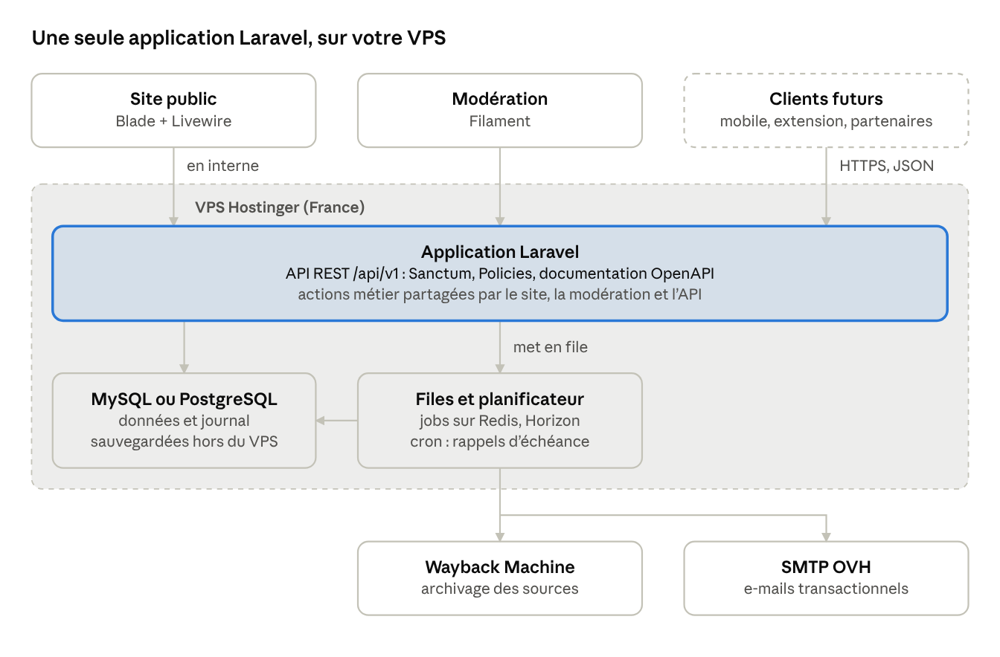

# Registre des promesses et prédictions — spécification

20 octobre 2026 · Charles Coiffier

## Résumé

Le site recense des **cartes** : une promesse ou une prédiction d'une personnalité publique, citée, datée et sourcée, qui reçoit un **verdict** sourcé à son échéance. Tout passe par une API, pour pouvoir ajouter plus tard d'autres clients (application mobile, extension navigateur, zone de prédictions des membres en V2).

Circuit retenu :

1. Un visiteur, inscrit ou non (e-mail obligatoire et confirmé), propose une carte.
2. Un modérateur ou l'administrateur la valide, la refuse, ou en modifie la rédaction. L'auteur est prévenu par e-mail ; un non-inscrit est invité à créer un compte.
3. À l'échéance, un membre inscrit propose un verdict sourcé.
4. Un modérateur ou l'administrateur valide le verdict ou le modifie. Personne ne valide sa propre proposition.

## Modèle de données

Neuf tables suffisent. Le cœur est la **carte**, rattachée à une **personnalité**, documentée par des **sources** et close par un **verdict**. Un **journal** garde la trace de chaque action de modération, ce qui permet de montrer publiquement qui a validé quoi.

Relations : une personnalité a plusieurs cartes et plusieurs affiliations ; une carte a plusieurs sources, plusieurs thèmes, au plus un verdict validé (mais plusieurs propositions successives) ; un verdict a ses propres sources.

Les noms ci-dessous sont en français pour la lecture. Dans le code, on les écrit en anglais (voir la correspondance dans `CLAUDE.md`).

### utilisateur

| Champ | Type | Note |
| --- | --- | --- |
| id | UUID | |
| email | texte, unique | confirmé avant toute action |
| pseudo | texte, unique | affiché publiquement |
| role | enum | membre, moderateur, admin |
| email_confirme_le | date-heure | vide tant que non confirmé |
| cree_le | date-heure | |

Les visiteurs non inscrits n'ont pas de ligne ici : leur e-mail est stocké sur la carte. S'ils s'inscrivent plus tard avec la même adresse, leurs cartes leur sont rattachées.

### personnalite

| Champ | Type | Note |
| --- | --- | --- |
| id | UUID | |
| nom | texte | |
| slug | texte, unique | pour les URL : /personnalites/jean-dupont |
| categorie | enum | politique, journaliste, editorialiste, economiste, autre |
| description | texte court | fonction actuelle |
| photo_url | texte | photo libre de droits uniquement |
| wikidata_id | texte | évite les homonymes, facilite les imports |

### affiliation

Une personnalité change de parti ou de média : on garde l'historique pour afficher l'affiliation *au moment* de la déclaration.

| Champ | Type | Note |
| --- | --- | --- |
| id | UUID | |
| personnalite_id | réf. | |
| organisation | texte | parti, média, gouvernement |
| role | texte | candidat, ministre, chroniqueur… |
| debut / fin | date | fin vide = en cours |

### carte

| Champ | Type | Note |
| --- | --- | --- |
| id | UUID | |
| personnalite_id | réf. | |
| type | enum | promesse, prediction |
| citation | texte | mot pour mot, obligatoire |
| contexte | texte | quelques phrases autour de la citation |
| date_declaration | date | obligatoire |
| reformulation | texte | version testable, souvent rédigée par le modérateur |
| critere_verdict | texte | comment on tranchera, et avec quelle donnée |
| echeance | date | |
| echeance_nature | enum | explicite, deduite (ex. fin de mandat) |
| statut | enum | voir cycle de vie ci-dessous |
| auteur_id | réf., nullable | membre auteur |
| auteur_email | texte, nullable | visiteur non inscrit |
| version | entier | incrémenté à chaque modification |
| cree_le / publiee_le | date-heure | |

Statuts : `attente_email` → `en_moderation` → `publiee` → `verdict_propose` → `close` ; ou `refusee` (avec motif) depuis la modération.

### source

| Champ | Type | Note |
| --- | --- | --- |
| id | UUID | |
| carte_id ou verdict_id | réf. | une source étaye l'un ou l'autre |
| url | texte | |
| archive_url | texte | copie Wayback Machine ou archive.today, créée automatiquement |
| nature | enum | article, video, audio, programme, reseau_social, journal_officiel, donnee_publique |
| media | texte | Le Monde, France Inter, INSEE… |
| date_publication | date | |
| horodatage | texte | position dans une vidéo ou un audio, ex. 12:34 |

### verdict

| Champ | Type | Note |
| --- | --- | --- |
| id | UUID | |
| carte_id | réf. | |
| valeur | enum | promesse : tenue, partiellement_tenue, compromis, abandonnee, caduque · prédiction : juste, partiellement_juste, fausse, inverifiable |
| justification | texte | |
| propose_par | réf. utilisateur | membre inscrit obligatoirement |
| statut | enum | propose, valide, refuse |
| valide_par | réf. utilisateur | différent de propose_par |
| propose_le / valide_le | date-heure | |

### theme et carte_theme

Un vocabulaire fermé géré par l'administrateur (économie, santé, sécurité, éducation, institutions…), et une table de liaison carte ↔ thème. Un thème « Présidentielle 2027 » peut servir d'étiquette de campagne.

### journal

| Champ | Type | Note |
| --- | --- | --- |
| id | UUID | |
| objet_type / objet_id | texte / UUID | carte, verdict, personnalite… |
| acteur_id | réf., nullable | vide pour une action système |
| action | enum | proposition, validation, refus, modification, signalement… |
| avant / apres | JSON | état de l'objet, pour l'historique public |
| commentaire | texte | motif de refus, note au contributeur |
| le | date-heure | |

### signalement

Un bouton « signaler une erreur » sur chaque carte publiée : `carte_id`, `email` ou `utilisateur_id`, `motif`, `statut` (ouvert, traite, rejete).

## Architecture et technologies

Une seule application Laravel porte l'API, le site public et le back-office de modération. Elle tourne sur le VPS Hostinger, et les e-mails partent par le SMTP de l'offre OVH. Les tâches lentes (archiver une source, envoyer un e-mail, signaler une échéance dépassée) passent par les files d'attente de Laravel.

Le principe « API d'abord » est tenu par le code, pas par le réseau : les règles métier vivent dans des classes d'action et des Policies, appelées à l'identique par les contrôleurs de l'API, les composants Livewire du site et Filament. Le site n'a donc pas besoin de passer par HTTP, et l'API `/api/v1` reste le contrat stable pour les futurs clients.

| Brique | Choix | Rôle |
| --- | --- | --- |
| API | Laravel : Sanctum, Form Requests, API Resources, Policies | jetons pour les futurs clients ; la règle « personne ne valide sa propre proposition » vit dans une Policy, donc partout |
| Documentation de l'API | Scramble | génère la documentation OpenAPI à partir du code |
| Site public | Blade + Livewire | rendu serveur, donc pages indexables et partageables ; formulaire de proposition réactif sans écrire de JavaScript |
| Modération | Filament | back-office complet (files, filtres, formulaires, actions Publier et Refuser) en peu de code |
| Base de données | PostgreSQL | recherche plein texte en français ; règles « une proposition en attente par carte » et « personne ne valide sa propre proposition » doublées en base |
| Tâches de fond | files Laravel sur Redis, Horizon, planificateur | archivage des sources, e-mails, rappels d'échéance (une seule ligne cron sur le VPS) |
| E-mails | Notifications Laravel par le SMTP OVH | confirmations, avis de publication ou de refus, invitations à s'inscrire |
| Anti-spam | ALTCHA + limitation de débit native de Laravel | sans cookie, compatible RGPD |
| Hébergement | VPS Hostinger, datacenter en France | Nginx, PHP-FPM, Supervisor pour les workers, certificat Let's Encrypt |
| Déploiement | Laravel Forge ou Ploi (payants), ou Deployer (gratuit) | installe le serveur et déploie à chaque mise à jour du dépôt Git |

**Trois points d'attention**

- **Les e-mails OVH.** Les offres de messagerie OVH ne sont pas conçues pour l'envoi en volume. Un membre du forum OVH cite de mémoire environ 200 envois par heure et par compte, un chiffre non officiel à vérifier auprès d'OVH. C'est largement suffisant au lancement. Utiliser une adresse dédiée (par exemple notifications@votre-domaine) et configurer SPF, DKIM et DMARC. Si le volume grossit, passer à un service transactionnel ne demandera qu'un changement de configuration dans Laravel.
- **Le VPS.** Mises à jour de sécurité, pare-feu, et surtout sauvegardes hors du VPS (base et copies archivées des sources), par exemple avec le paquet spatie/laravel-backup. Hostinger indique que l'emplacement d'un VPS ne peut plus être changé après sa création.
- **Le nommage.** Eloquent suppose des noms de tables anglais au pluriel. Le code est écrit en anglais (cards, public_figures, verdicts, sources), l'interface en français.

Ordre de construction conseillé : les migrations et Filament d'abord (saisie des premières cartes à la main), puis l'API et le site public, puis l'ouverture des propositions.

Sources : [Hostinger, emplacements des serveurs](https://www.hostinger.com/support/1583267-where-are-hostinger-servers-located/) · [Forum OVHcloud, quotas SMTP](https://community.ovhcloud.com/t/quota-smtp-quelles-limites/10955)

## Endpoints principaux de l'API

API REST en JSON, versionnée sous `/api/v1`, documentée automatiquement en OpenAPI. Les lectures publiques ne demandent pas d'authentification ; les écritures exigent soit un compte, soit un e-mail confirmé par lien.

| Méthode | Route | Qui | Rôle |
| --- | --- | --- | --- |
| GET | /cartes | public | liste filtrable (personnalité, type, thème, statut, échéance avant/après) et paginée |
| GET | /cartes/{id} | public | carte publiée avec sources, verdict et historique |
| POST | /cartes | visiteur ou membre | propose une carte ; sans compte, envoie un lien de confirmation à l'e-mail fourni |
| GET | /confirmations/{jeton} | visiteur | confirme l'e-mail ; la carte passe en modération |
| PATCH | /cartes/{id} | modérateur | modifie la rédaction (l'auteur est notifié) |
| POST | /cartes/{id}/decision | modérateur | valide ou refuse, avec motif |
| POST | /cartes/{id}/verdicts | membre | propose un verdict sourcé |
| POST | /verdicts/{id}/decision | modérateur | valide, refuse ou modifie le verdict |
| POST | /cartes/{id}/signalements | public | signale une erreur |
| GET | /personnalites, /personnalites/{slug} | public | fiches et statistiques (cartes, taux de promesses tenues, prédictions justes) |
| POST, PATCH | /personnalites | modérateur | crée ou corrige une fiche |
| GET | /moderation/file | modérateur | cartes, verdicts et signalements en attente |
| GET | /echeances | public | cartes dont l'échéance arrive ou est dépassée sans verdict |
| POST | /comptes, /sessions | public | inscription, connexion, réinitialisation de mot de passe |

Dans le code, les routes sont en anglais (`/api/v1/cards`, `/api/v1/public-figures`…) ; voir `CLAUDE.md`.

Règles appliquées par l'API, pas seulement par l'interface : un modérateur ne peut pas décider sur sa propre proposition ; une seule proposition de verdict en attente par carte ; limitation du nombre de propositions par e-mail et par adresse IP.

## Maquettes des écrans principaux

Quatre écrans sont maquettés dans `docs/maquettes/` (ouvrir `index.html` dans un navigateur ; les pages sont reliées entre elles). Les contenus sont fictifs. « Parole tenue » est un nom de travail.

| Écran | Fichier | Ce qu'il montre |
| --- | --- | --- |
| Toutes les cartes | index.html | barre latérale de vues (verdict attendu, échéances à venir, tranchées), personnalités et thèmes ; grille de cartes groupées par section, un rond d'état coloré par verdict sur chaque carte |
| Fiche d'une carte | Carte.html | fenêtre de détail : citation, contexte, critère, verdict sourcé et historique à gauche ; métadonnées (personnalité, échéance, thèmes) à droite |
| Ajout rapide | Proposer.html | fenêtre ouverte par la touche Q : citation, puces personnalité, date, type, échéance, thèmes, lien source ; e-mail et anti-robot pour les non-inscrits |
| Modération | Moderation.html | tableau à trois colonnes (cartes à relire, verdicts à valider, signalements) ; ses propres propositions grisées |

Le style reprend les principes de Todoist (sobriété, vues dans une barre latérale, ajout rapide au clavier) avec sa propre identité : bleu `#2552C6` comme couleur d'accent, typographie Inter, organisation de l'écran principal en cartes.
